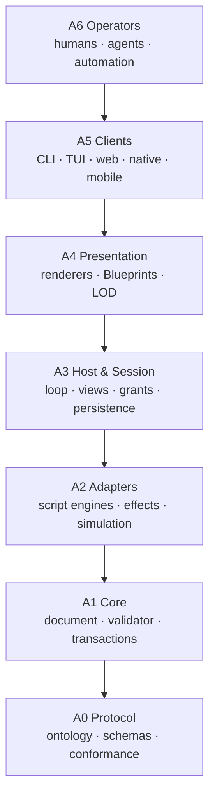

# Blockies

An agent-operated visualization platform. Users provide information and intent; external AI
agents build and operate a visual World out of a small, deliberately fixed vocabulary of
Blockies. Expression comes from composition and interaction, never from inventing new
primitives.

This repository is the entry point for the organisation. It holds the map, the conventions, and
the bootstrap script — not the code.

## Start here

```bash
git clone https://github.com/blockieslabs/home.git
cd home
./bootstrap.sh          # clones the sibling repositories next to this one
```

Then open `../docs/html/index.html` in a browser. It is a linked field guide that explains the
whole architecture in plain language, with diagrams and a glossary.

## Repositories

| Repository | What it is | Status |
|---|---|---|
| [docs](https://github.com/blockieslabs/docs) | Architecture record: decisions, specifications, traces, schema, field guide | **active** |
| `spec` | Normative protocol text and JSON Schemas, split out of `docs` | planned |
| `core` | Document model, validator, transaction engine (Rust, WASM-capable) | planned |
| `adapters` | Script engines, effect executor, simulation services | planned |
| `host` | Session loop, persistence, views, grants | planned |
| `render` | Renderers and Type renderer packages | planned |
| `clients` | CLI, TUI, web, native desktop, mobile | planned |
| `operators` | Agent adapters, package sources | planned |

One repository per architecture level. A level gets a repository when it has something to build,
not before.

## The stack



Dependencies point up only. No layer reaches past its neighbour.

## What exists today

The design is complete enough to implement against. There is no code yet.

- **46 decisions**, recorded and cross-checked for consistency.
- **Three specifications** — core model, process, composite — with numbered requirements
  (`C-n`, `P-n`, `S-n`) so they can be cited.
- **Four execution traces** that the specifications were derived from and are tested against.
- **A JSON Schema** with 29 conformance vectors, validated against a complete example World.
- **A performance analysis** with 120 findings across A0–A6, each with the technique that
  removes the cost without changing a trace.
- **A field guide** in HTML for learning the model.

Three things are deliberately still open: the effects protocol, the canonical encoding used for
digests, and a World policy editor.

## Conventions

See [`CONVENTIONS.md`](CONVENTIONS.md). The short version: decisions are append-only,
specifications own meaning, the schema owns shape, and nothing is stored that can be derived.

## Licence

Undecided. Do not assume a licence until one is added.
